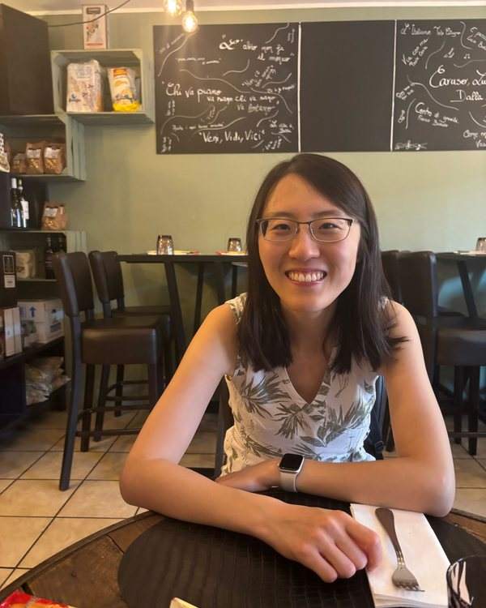

# A bit about me

My first name, 晓琦 (Xiaoqi), is pronounced "Sh-ih-ow Chi" and means *jade born at dawn* in Chinese. Most people call me Shirley, and I publish as both Xiaoqi Liu and Shirley Xiaoqi Liu.

I grew up in China, where my family moved between districts, cities, and provinces at almost every stage of my education. I later attended secondary school in Singapore before moving to the UK for university, my PhD, and now work. Living in different places has broadened my perspective and taught me to appreciate different ways of life, as well as different ways of thinking about and approaching research.

I try to be precise about what a result establishes and equally clear about its limitations, as  intellectual honesty and rigour are fundamental to good research. I've also come to realise that  clear thinking and clear communication  reinforce each other, so I always try to communicate ideas in a way that leaves others with some new understanding, however small.   I find this one of the most rewarding parts of research. 

If anything in my work is unclear, I'd love to hear about it. I'm always happy to discuss further, and questions often help me find better ways to think about things or explain things. Thank you for visiting my website :)