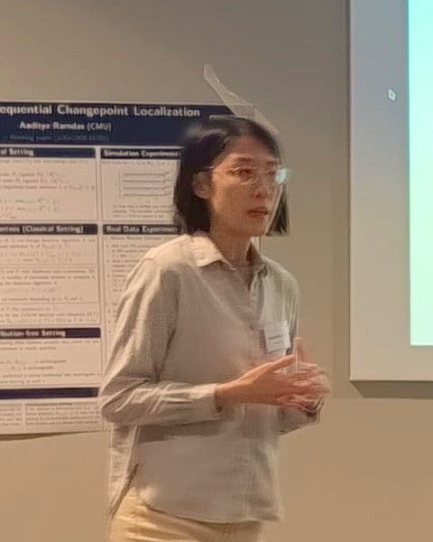

# Talks

I believe talks are an important way to communicate theoretical research. As AI makes technical material increasingly easy to produce and access, I think the  human side of research becomes even more valuable: sharing not just what we have discovered, but how we approach problems, the intuition behind mathematical results, and the reasoning that leads to them. To me, research is more about the  journey of understanding  than it is about the final results.

I therefore strive to make my talks as clear, visual, and accessible as possible, and to connect technical ideas to broader questions. My hope is that everyone in the audience, regardless of their familiarity with the topic, leaves with some new insight or perspective, however small.

Here are some of my recent and upcoming talks:

<ol class="talks">
<li>
When to Stop Gradient Descent: Minimax Optimal Early Stopping for Classification
<ul class="venues">
<li>Upcoming: Machine Learning Theory Seminar, University of Cambridge, Feb&nbsp;2027</li>
<li>Upcoming: IMS International Conference on Statistics and Data Science, Croatia, Dec&nbsp;2026</li>
<li>Upcoming: Computational Statistics and Machine Learning Reading Group, Imperial College London, Dec&nbsp;2026</li>
<li>Department of Statistics, University of Oxford, Nov&nbsp;2026</li>
<li>Statistics Seminar, University of Bristol, Oct&nbsp;2026 <a class="tag" href="Early_stopped_GD_45mins_10QA.pdf">slides</a></li>
</ul>
</li>
<li>

Bayes-Assisted Confidence Sequences for CDFs
Safe Anytime-Valid Inference Conference, University of Twente, Jul&nbsp;2026 <a class="tag" href="SAVI_2026_poster.pdf">poster</a>
</li>
<li>
Mind the U Curve: Why We Stop Gradient Descent Early
Meet Our Group Seminar Series, University of Oxford, May&nbsp;2026 <a class="tag" href="talk_on_early_stopped_GD(10mins).pdf">slides</a>
</li>
<li>
Learning Under Non-Stationarity: Statistical Inference and Bandit Convex Optimization
Algorithms and Computationally Intensive Inference Seminar, University of Warwick, Mar&nbsp;2026 <a class="tag" href="warwick_stats_seminar_final.pdf">slides</a>
</li>
<li>
Tight Confidence Sequences From Universal Portfolio
Hypothesis Testing with E-values Reading Group, University of Oxford, Mar&nbsp;2026 <a class="tag" href="Reading_group_talk_on_universal_portfolio.pdf">slides</a>
</li>
<li>
Non-Stationary Bandit Convex Optimization: Algorithms and Links to Coin Betting
Algorithmic Statistics Workshop, University of Oxford, Nov&nbsp;2025 <a class="tag" href="CDT_bandits_talk(20mins).pdf">slides</a>
</li>
<li>
Sequential Anytime-Valid Inference Using E-processes
Hypothesis Testing with E-values Reading Group, University of Oxford, Oct&nbsp;2025 <a class="tag" href="Ramdas_Wang_ebook_chapter7-2.pdf">slides</a>
</li>
<li>
Loss Landscapes and Optimization in Over-Parameterized Neural Networks
Learning Theory and Statistical Optimization Reading Group, University of Oxford, Nov&nbsp;2024 <a class="tag" href="learning_theory_reading_group.pdf">slides</a>
</li>
<li>
Communication over Many-User Channels via Approximate Message Passing
Information Theory Seminar, University of Cambridge, May&nbsp;2024 <a class="tag" href="IT_seminar_GMAC_220524_github.pdf">slides</a>
</li>
</ol>
