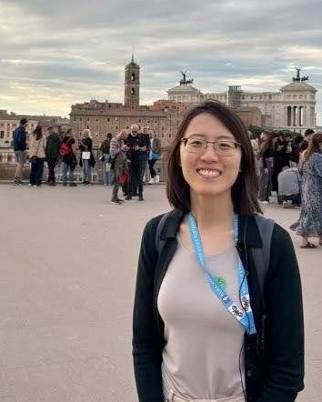

# Mentoring & Teaching

Throughout my academic journey, I have been fortunate to have met and learnt from many wonderful teachers, mentors, and peers. Their empathy, admirable work ethic, and genuine love for their work have profoundly influenced me. 

By observing how they work, I learnt that good scientific practice requires honesty and precision in making claims, persistence in seeking simple and elegant solutions, and patience in understanding difficult problems deeply. Now as a mentor myself, I hope to pass on these values by helping younger researchers develop their own ways of thinking, build confidence, and grow intellectually.

Over the past decade, I have been involved in a range of teaching, supervision and outreach activities, sharing my enthusiasm for probability, statistics, and information theory with my students.  I particularly focus on making complex ideas accessible without sacrificing rigour. In helping students develop intuition, I often gain new insights myself, which makes teaching especially rewarding.  I hope to make teaching and mentoring a lasting part of my career.

## Teaching

- Lecturer, Oxford Statistics in AI CDT module: tutorial on sequential anytime-valid inference using e-processes, Nov 2025 <a class="tag" href="SAVI_tutorial_shirley.pdf">slides</a>
- Supervisor for Cambridge third-year courses on Information 
Theory and Coding  (3F7) and Data Transmission (3F4), 2019–2024
- Supervisor for the Cambridge AI+ Programme, 2022–2023

## Research supervision

- Oxford MSc projects, 2025–present: sequential inference for time-to-unsafe monitoring, prediction-powered inference, and in-context learning in language models <a class="tag" href="MSc_project_2025_Liu_Rebeschini.pdf">proposal</a>
- Oxford UNIQplus research internship, 2026: sequential inference
- Cambridge MEng projects, 2023–2024: high-dimensional statistical estimation for heterogeneous data

## Outreach

- Project lead, Micro Distance International Youth Forum, 2019
- Volunteer, Cambridge Hands-On Science, 2019
-  Volunteer maths teaching assistant, weekly classes in secondary schools, Cambridge STIMULUS programme, 2018